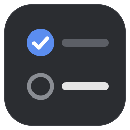
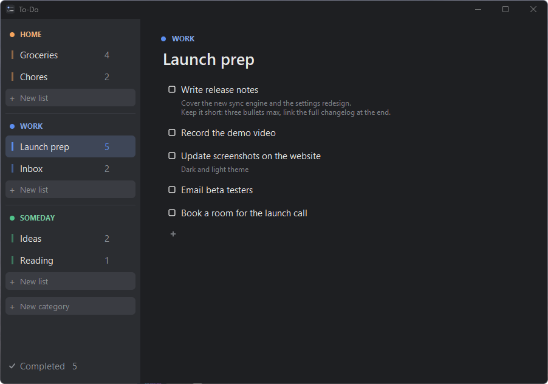
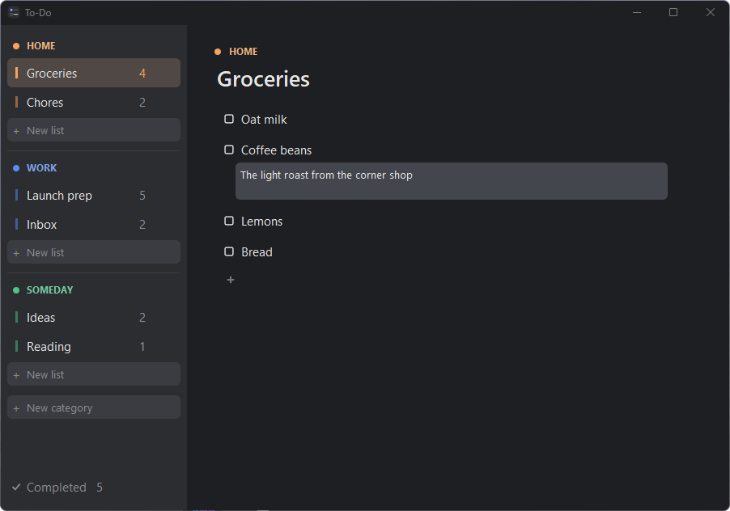
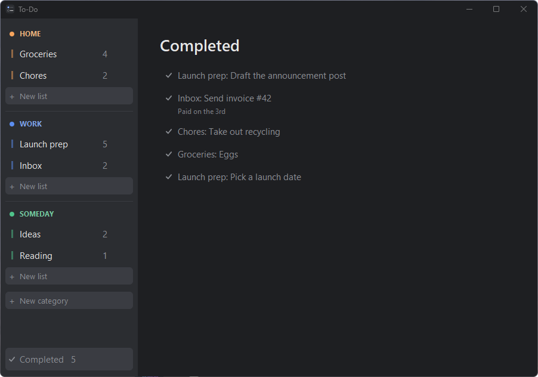

<p align="center">
  
</p>

<h1 align="center">To-Do Checklist</h1>

<p align="center">
  A calm, dark-themed to-do app for Windows.<br>
  One Python file, no dependencies, no account, no cloud.
</p>

<p align="center">
  
</p>

## Why

Most to-do apps want you to sign up, sync and subscribe. This one is a single window that opens
instantly, keeps everything in a plain JSON file next to the script, and stays out of your way.

## Features

- **Categories and lists:** group lists under colored categories like *Home*, *Work* or *Someday*.
- **Notes on any task:** add as many lines as you need. The whole note shows under the task.
- **Click to edit:** click any task, list or category name, or the list title, to rename it in place.
- **Check off with the checkbox:** finished tasks move to **Completed**. Click the checkmark there to return one.
- **Undo:** press <kbd>Ctrl</kbd>+<kbd>Z</kbd> to bring back the last task you checked off.
- **Drag and drop:** reorder tasks, and move lists between categories.
- **Uncluttered:** delete buttons only appear on the row you're hovering, and nothing opens a dialog.
- **Native feel:** a dark title bar, smooth rounded corners, and it remembers its size and position.

<table>
  <tr>
    <td width="50%"></td>
    <td width="50%"></td>
  </tr>
  <tr>
    <td align="center"><sub>Click a note to edit it. It saves as you type.</sub></td>
    <td align="center"><sub>Everything you've finished, ready to restore</sub></td>
  </tr>
</table>

## Getting started

You need **Windows 10 or 11** and **Python 3** (Tkinter ships with the standard Windows installer).

1. Download or clone this repository:
   ```
   git clone https://github.com/donnieholstrom/ToDoChecklist.git
   ```
2. Double-click **`todo.pyw`**, or run:
   ```
   pythonw todo.pyw
   ```
3. Optional: run **`Make Shortcut.bat`** to create a `To-Do.lnk` shortcut with the app icon, which you
   can pin to Start or the taskbar. It expects `pythonw.exe` from the
   [Python install manager](https://docs.python.org/3/using/windows.html) at `%LOCALAPPDATA%\Python\bin`.
   If your Python is somewhere else, edit that path in the `.bat` file.

## Keyboard shortcuts

| Keys | Action |
| --- | --- |
| <kbd>Enter</kbd> | Save a name, or add a task and start the next one |
| <kbd>Esc</kbd> | Cancel editing |
| <kbd>Ctrl</kbd>+<kbd>Enter</kbd> | Close the note you're editing |
| <kbd>Ctrl</kbd>+<kbd>Z</kbd> | Undo the last check-off |
| <kbd>Ctrl</kbd>+<kbd>N</kbd> | New category |

## Your data

Everything is saved to **`todo.json`** in the same folder as the script. It's plain JSON, so it's easy
to back up, sync with a folder service, or edit by hand. Saves are atomic: a crash or power cut can't
leave the file half-written.

## License

[MIT](LICENSE)
